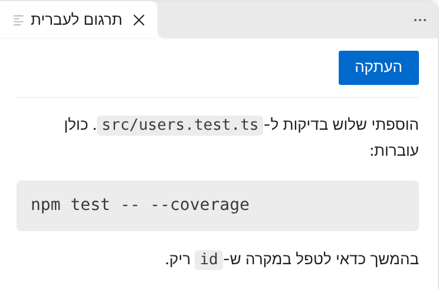

<div dir="rtl">

# Hebrew Mode for Claude Code

כותבים ל-Claude Code בעברית, ו-Claude מקבל אנגלית. מעתיקים תשובה של Claude, וקוראים אותה בעברית. התרגום רץ ב-Google Gemini עם מפתח API אישי (יש מסלול חינמי), והכול עובר דרך הלוח.

המטרה היא לחסוך טוקנים ב-Claude Code: טקסט בעברית צורך יותר טוקנים מאותו טקסט באנגלית, וטוקני פלט יקרים במיוחד.

> **תצוגה מקדימה (Preview).** זו הגרסה הראשונה. נשמח לדירוג, לביקורת ולדיווח על באגים.



## איך משתמשים

### פעם אחת: התקנה והגדרה

1. **התקנה:** ב-VS Code פותחים את תצוגת התוספים (Ctrl+Shift+X), מחפשים "Hebrew Mode" ולוחצים Install. אפשר גם להתקין מקובץ VSIX (הסבר בהמשך).
2. **מפתח Gemini בחינם:** לוחצים Ctrl+Shift+P ובוחרים **Hebrew Mode: Set API Key (הגדרת מפתח)**. נפתח דף של Google AI Studio: לוחצים **Create API key**, מעתיקים את המפתח ומדביקים אותו בשדה שנפתח ב-VS Code.
3. **פרטיות:** בפעם הראשונה מופיעה הודעה קצרה על הפרטיות במסלול החינמי. קוראים ומאשרים.
4. **ש-Claude יענה באנגלית:** מוסיפים את השורה `Always respond in English` לקובץ `~/.claude/CLAUDE.md`. ההסבר המלא בהמשך.

### בכל יום: כותבים ל-Claude בעברית

1. כותבים בעברית בשדה של Claude Code.
2. מסמנים הכול ומעתיקים: Ctrl+A ואז Ctrl+C.
3. לוחצים Ctrl+Alt+E. התרגום לאנגלית נכנס ללוח, והסמן חוזר לשדה של Claude.
4. Ctrl+V מחליף את העברית באנגלית. בודקים ושולחים עם Enter.

התרגום לא מוצא חן? Ctrl+Alt+Z מחזיר ללוח את הטיוטה העברית האחרונה.

### בכל יום: קוראים תשובה של Claude בעברית

1. מסמנים את התשובה, כולה או חלק ממנה, ומעתיקים עם Ctrl+C.
2. לוחצים Ctrl+Alt+H. נפתח בצד חלון עם התרגום לעברית, הקוד נשאר כמו שהוא, ויש כפתור העתקה.

התרגום לעברית לא נכנס לשיחה עם Claude ולא עולה טוקנים של Claude. ב-Mac לוחצים Control+Option במקום Ctrl+Alt.

### מה התוסף עושה ומה לא

- הוא רק שם טקסט בלוח ופותח חלון תרגום בצד. שום דבר לא נשלח ל-Claude: את ההדבקה ואת ה-Enter עושים בעצמכם.
- הוא לא נוגע ב-Claude Code: לא משנה קבצים, הגדרות או hooks. נקודות המגע היחידות הן הלוח והפקודה `claude-vscode.focus`, שמחזירה את הסמן לשדה של Claude.
- אף טקסט לא הולך לאיבוד. כשמשהו נכשל, הלוח נשאר עם הטקסט המקורי, והטיוטה העברית האחרונה תמיד ניתנת לשחזור.

## קיצורי מקלדת

| קיצור | ב-Mac | מה קורה |
| --- | --- | --- |
| Ctrl+Alt+E | Control+Option+E | תרגום לאנגלית: הטקסט שבלוח מתורגם, האנגלית נכנסת ללוח, והסמן חוזר לשדה של Claude |
| Ctrl+Alt+H | Control+Option+H | תרגום לעברית: הטקסט שבלוח מוצג בעברית בחלון בצד, עם כפתור העתקה |
| Ctrl+Alt+Z | Control+Option+Z | שחזור: הטיוטה העברית האחרונה חוזרת ללוח |

התוסף מזהה את שפת הטקסט לפי שיעור האותיות העבריות (ובמקרה גבולי, כמו הוראה קצרה מלאה במונחים באנגלית, לפי המילה הראשונה). לחיצה על Ctrl+Alt+E כשבלוח יש טקסט באנגלית מציגה אותו בעברית בחלון התרגום, והלוח לא משתנה. Ctrl+Alt+H על טקסט שכבר בעברית רק מציג הודעה.

## ש-Claude יענה באנגלית

כדי שגם התשובות יחסכו טוקנים, Claude צריך לענות באנגלית. מוסיפים לקובץ ה-CLAUDE.md האישי את השורה:

</div>

```text
Always respond in English
```

<div dir="rtl">

הקובץ נמצא ב-`~/.claude/CLAUDE.md` (ב-Windows: `%USERPROFILE%\.claude\CLAUDE.md`). אם הוא לא קיים, אפשר ליצור אותו. ב-Mac או Linux:

</div>

```bash
mkdir -p ~/.claude && echo "Always respond in English" >> ~/.claude/CLAUDE.md
```

<div dir="rtl">

ב-Windows (PowerShell):

</div>

```powershell
New-Item -ItemType Directory -Force "$env:USERPROFILE\.claude" | Out-Null; Add-Content "$env:USERPROFILE\.claude\CLAUDE.md" "Always respond in English"
```

<div dir="rtl">

כדאי לבדוק גם שאין בקובץ הזה, או בקובצי CLAUDE.md של הפרויקטים, הוראה לענות בעברית. הוראה כזו מבטלת את החיסכון בצד הפלט.

## התקנה מקובץ VSIX

למי שמעדיפים להתקין מקובץ:

1. מורידים את קובץ ה-VSIX.
2. ב-VS Code פותחים את תצוגת התוספים (Ctrl+Shift+X), לוחצים על תפריט שלוש הנקודות בראש התצוגה ובוחרים **Install from VSIX...**.
3. אפשר גם מהטרמינל:

</div>

```bash
code --install-extension hebrew-mode-0.1.0.vsix
```

<div dir="rtl">

דרישות: VS Code בגרסה 1.90 ומעלה, והתוסף של Claude Code. בלי התוסף של Claude Code התרגום עדיין נכנס ללוח, ומופיעה הודעה ללחוץ על השדה ולהדביק.

## הגדרת מפתח Gemini: פרטים

- הגדרת המפתח נפתחת לבד בתרגום הראשון, ואפשר להפעיל אותה שוב בכל זמן כדי להחליף מפתח.
- התוסף בודק את המפתח ובוחר לבד את מודל ה-Flash-Lite היציב החדש ביותר שזמין לו.
- בלי אישור הודעת הפרטיות המפתח לא נשמר, ושום דבר לא נשלח.
- המפתח נשמר ב-SecretStorage של VS Code (מחזיק הסיסמאות של מערכת ההפעלה). אם לא נשמר מפתח, התוסף משתמש במשתנה הסביבה `HEBREW_MODE_GEMINI_KEY` כגיבוי.

## מילון מונחים

מונחים במילון לא מתורגמים בשום כיוון ונשארים בדיוק כמו שהם, למשל `deploy`, `commit`, `Supabase` או שמות של קומפוננטות בפרויקט. אפשר להגדיר אותם בשני מקומות:

- בהגדרה `hebrewMode.glossary` (בהגדרות המשתמש או ה-Workspace).
- בקובץ `.hebrew-mode.json` בשורש הפרויקט:

</div>

```json
{ "glossary": ["deploy", "commit", "Supabase", "UserCard"] }
```

<div dir="rtl">

## הגדרות

| הגדרה | ברירת מחדל | הסבר |
| --- | --- | --- |
| `hebrewMode.enabled` | `true` | כשהיא כבויה, שום טקסט לא נשלח ל-Gemini. כדאי לכבות אותה בהגדרות ה-Workspace של פרויקט רגיש, למשל ריפו של לקוח |
| `hebrewMode.modelTier` | `flash-lite` | `flash` נותן איכות גבוהה יותר, אבל המכסה החינמית שלו קטנה בהרבה |
| `hebrewMode.model` | ריק | מזהה מודל מדויק שגובר על הבחירה האוטומטית |
| `hebrewMode.glossary` | `[]` | מונחים שלא מתרגמים |

## פרטיות ואבטחה

**במסלול החינמי של Gemini, Google רשאית להשתמש בטקסט שנשלח לתרגום כדי לשפר את המוצרים שלה, ובודקים אנושיים עשויים לקרוא חלק ממנו.** זה חל גם על משתמשים בישראל (הפטור הוא רק לאזור הכלכלי האירופי, שוויץ ובריטניה). במסלול בתשלום התוכן לא משמש לשיפור. לכן מומלץ לא לתרגם קוד או מידע של לקוחות במסלול החינמי.

מה מצמצם את החשיפה:

- נשלח רק הטקסט שהועתק. התוסף לא שולח קבצים, הקשר מהפרויקט או את השיחה עם Claude.
- בלוקי קוד לא נשלחים בכלל. גם קוד בשורה, נתיבים, כתובות, פקודות ודגלים, משתני סביבה, שמות של פונקציות ומשתנים, @mentions ומונחי המילון מוחלפים בסמנים כמו ⟦P7⟧ ונשארים במחשב. אחרי התרגום כל סמן חייב לחזור בדיוק פעם אחת, אחרת התרגום נזרק.
- שומר הסודות סורק כל טקסט לפני השליחה (מפתחות API נפוצים, JWT, private key, שורות KEY=value מקובצי env). אם נמצא משהו, השליחה נעצרת ומוצגת השורה. "הסתר ותרגם" מחליף את הסוד בסמן מוגן, כך שהוא לא נשלח.
- אפשר לכבות את התוסף בפרויקט מסוים עם `hebrewMode.enabled`.

אבטחת המפתח:

- המפתח נשמר רק ב-SecretStorage של VS Code, או במשתנה הסביבה `HEBREW_MODE_GEMINI_KEY` למי שבחרו בזה.
- הוא נשלח רק ל-`generativelanguage.googleapis.com`, ב-header בשם `x-goog-api-key`, ולעולם לא בכתובת ה-URL.
- הוא לא מופיע בלוגים או בהודעות שגיאה. לתוסף אין לוגים בכלל.

אין טלמטריה, אין שרת, ותרגומים לא נשמרים על הדיסק. המטמון והטיוטה העברית נמצאים בזיכרון בלבד ונמחקים עם סגירת VS Code. מה שכן נשמר במצב של VS Code: אישור הודעת הפרטיות, שם המודל שנבחר, ומונה התרגומים היומי (מספר בלבד).

## מכסות במסלול החינמי

| מודל | בקשות לדקה | בקשות ליום |
| --- | --- | --- |
| Flash-Lite (ברירת מחדל) | 10 | 500 |
| Flash | 5 | 20 |

המספרים מנובמבר 2026, ו-Google משנה אותם מדי פעם, ולכן התוסף לא מניח אותם. המכסה היומית מתחדשת בחצות שעון הפסיפי, בדרך כלל ב-10:00 בבוקר שעון ישראל. בשורת הסטטוס יש מונה של התרגומים שנשלחו היום. התוסף אף פעם לא עובר לבד למסלול בתשלום או למודל אחר.

## כשמשהו לא עובד

בכל המקרים האלה הלוח נשאר עם הטקסט המקורי.

| מה רואים | מה עושים |
| --- | --- |
| נפתחת הגדרת המפתח | המפתח חסר או לא תקין. מדביקים מפתח חדש מ-AI Studio |
| "העתיקי קודם את הטקסט" | הלוח ריק. מסמנים ומעתיקים לפני הקיצור |
| "נסי שוב בעוד X שניות" | הגעתם למגבלת הבקשות לדקה |
| המכסה היומית נגמרה | ההודעה אומרת מתי היא מתחדשת בשעון ישראל. אפשר גם לעבור ל-Flash בהגדרות, עם מכסה נפרדת וקטנה |
| "התרגום נכשל" | תקלת רשת או תשובה פגומה מ-Gemini. מנסים שוב |
| "התרגום שינה קוד, בוטל" | Gemini שינה או השמיט סמן של קוד, אז התרגום נזרק כדי שקוד לא ישתנה. מנסים שוב, או מקצרים את הטקסט |
| "נמצא בטקסט משהו שנראה כמו מפתח או סיסמה" | בוחרים "הסתר ותרגם", או מסירים את הסוד מהטקסט |
| "לחצי על השדה של Claude והדביקי" | הפקודה `claude-vscode.focus` לא קיימת (למשל כש-Claude Code לא מותקן). התרגום כבר בלוח |
| הקיצור מקליד תו במקום לתרגם | ב-Windows עם פריסת מקלדת עברית, Ctrl+Alt משמש לפעמים כ-AltGr. משנים את הקיצור: Ctrl+K Ctrl+S, מחפשים "Hebrew Mode" ומגדירים קיצור אחר |

## דירוג ומשוב

התוסף עוזר לך? נשמח לדירוג ולביקורת בחנות התוספים של VS Code. זה עוזר למשתמשים אחרים למצוא אותו. באגים והצעות לשיפור אפשר לפתוח ב-[Issues ב-GitHub](https://github.com/Mali9868/hebrew-mode-vscode/issues).

## בנייה מהקוד

</div>

```bash
npm install
npm test
npm run package
```

<div dir="rtl">

`npm run package` יוצר את קובץ ה-VSIX. אין לתוסף תלויות בזמן ריצה.

בתיקייה `test/e2e` יש בדיקות קצה לקצה שמריצות את ה-VSIX ב-VS Code אמיתי (code-server) דרך Playwright. התוצאות והסבר איך הן הורצו נמצאים בקובץ `docs/ACCEPTANCE.md`.

## רישיון והבהרה

MIT. ראו את הקובץ LICENSE.

התוסף הוא פרויקט עצמאי, ואינו מוצר רשמי של Anthropic או של Google. Claude ו-Claude Code הם סימנים מסחריים של Anthropic, ו-Gemini הוא סימן מסחרי של Google.

</div>
